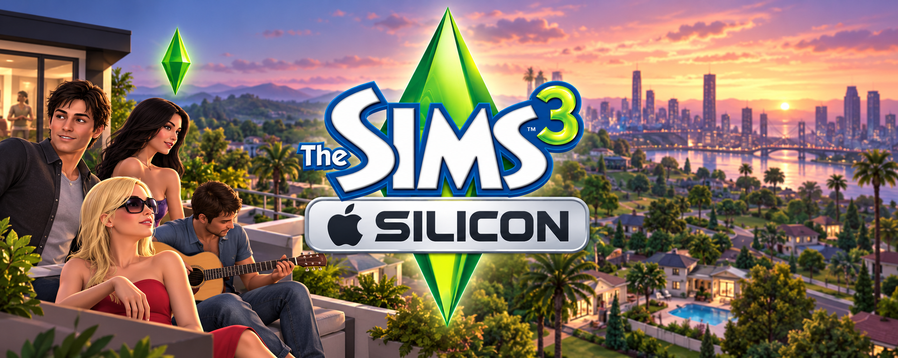

# The Sims 3 Silicon

**An unofficial community research and preservation project.** Not affiliated with, endorsed by, or sponsored by Electronic Arts or Maxis.

The Sims 3 and related names are trademarks of their respective owners. This repository contains no game files and grants no rights to game content.

## Purpose

This project explores responsible community research into preserving and understanding The Sims 3 on macOS, especially Apple silicon Macs. Topics include memory behavior, ARM64 execution, graphics performance, and the feasibility of Metal-related research.

We share original documentation, measurement methods, and original tools or code. Contributors use their own legally obtained copy where needed. Compatibility, performance improvements, an ARM64 port, and Metal support are not promised.

## Scope and limits

- This repository includes one project-owner-provided presentation banner at [assets/banner-sunset.png](assets/banner-sunset.png). It is outside the source-code license; this exception applies only to that image.
- Do not submit or distribute game binaries, source code, extracted assets, audio, video, textures, fonts, save files, installers, keys, modified executables, or other proprietary game materials.
- Do not submit decompiled or disassembled game code, copied proprietary code, or raw diagnostic captures that may contain game content or personal information.
- This project does not provide or seek ways to bypass DRM, license checks, or other access controls.
- Research must comply with applicable law and relevant agreements. Contributors are responsible for assessing their own work and submissions.
- Share sanitized summaries instead of raw crash reports, memory dumps, traces, or screenshots.
- The project is experimental and offers no compatibility, performance, stability, or support guarantees.

## Investigation roadmap

These are research questions, not promised outcomes.

1. **Establish a baseline:** record repeatable workloads and aggregate memory observations such as resident memory, memory pressure, and swap use.
2. **Study memory behavior:** document methods, results, and limitations without redistributing game code or data.
3. **Investigate ARM64:** document publicly observable architecture and runtime facts; assess original tooling and legally permitted interoperability research. Do not assume a native ARM64 build is possible.
4. **Investigate graphics and Metal:** measure observable behavior and bottlenecks; explore ideas in a separate original test harness with synthetic or openly licensed assets.
5. **Review findings:** validate original tools, report limitations, and update the roadmap based on evidence.

### Marco 0 — baseline ARM64 (2026-10-26)

The installed 1.67.2 bundle was inspected read-only. On the inspected ARM64 Mac, its Wineskin launcher is x86_64; the bundled Wine support files identify Wine 4.18 and include x86 and x86_64 host executables. The three principal Windows executables in the base game directory are 32-bit x86 PE files. The game runtime executable directly imports `d3d9.dll` and `d3dx9_31.dll`, establishing DirectX 9 imports. Strict code-signature verification fails: the sealed `Info.plist` mismatches, and macOS execution assessment reports a sealed resource-directory mismatch. The corrected `.ips` reader found nine matching local records; their structured termination fields classify them as code-signing failures. The report exposes only count and category. Runtime compatibility remains untested.

An original Python diagnostic and synthetic ARM64 memory-boundary lab make this baseline reproducible. See [Marco 0: evidências e reprodução](docs/marco-0-arm64.md) and the sanitized [baseline report](docs/marco-0-diagnostico.json). The next ARM64 checks are Rosetta availability, the 32-bit Windows-on-Wine path on the current macOS release, and a separately controlled launch with sanitized failure evidence.

### Marco 1 — x86 instruction subset

The ARM64 C++17 lab now interprets a small, documented x86 subset over original byte sequences with separate synthetic code and data. It covers register/immediate moves, little-endian data moves, 32-bit arithmetic, ZF and short relative branches; it does not load PE or game code. The `.ips` parser now reads both single-object and header/body JSON reports and summarizes nine matching local code-signing failures. See [Marco 1: interpretador e reprodução](docs/marco-1-x86-subset.md).

### Marco 2 — static executable map

The static map for the three original Windows executables is complete. See [Marco 2](docs/marco-2-mapa-estatico.md).

### Marco 3 — open the original launcher

The goal is to make the original launcher window appear; the game does not need to start yet. Our first attempt was rejected by macOS before any window appeared. The local diagnostic reports an invalid app signature, while Rosetta is installed. This attempt does not yet tell us whether Wine or the Windows launcher can run. See [Marco 3](docs/marco-3-launcher.md).

Separately, the C++ lab now loads original synthetic PE32 fixtures into simulated memory without executing them. See the [PE32 loader experiment and reproduction](docs/marco-3-carregador-pe32.md).

Read [CONTRIBUTING.md](CONTRIBUTING.md) and [IP-POLICY.md](IP-POLICY.md) before participating. [LICENSE-CODE.md](LICENSE-CODE.md) applies only to original source code, not documentation, third-party material, or game content.

## Português

**Projeto comunitário independente de pesquisa e preservação; não oficial e sem vínculo, endosso ou patrocínio da Electronic Arts ou da Maxis.**

O projeto investiga questões de memória, execução ARM64 e gráficos/Metal de The Sims 3 no macOS, especialmente em Macs Apple silicon, sem prometer compatibilidade ou melhorias. O repositório aceita somente documentação, métodos, ferramentas e código originais. Não inclua arquivos do jogo, conteúdo extraído, executáveis modificados, dumps ou capturas brutas. Consulte [CONTRIBUTING.md](CONTRIBUTING.md) e [IP-POLICY.md](IP-POLICY.md).

**Marco atual: abrir o launcher original.** A primeira tentativa foi bloqueada pelo macOS antes de qualquer janela aparecer; o diagnóstico aponta assinatura inválida. O Rosetta está instalado. Veja o [registro do Marco 3](docs/marco-3-launcher.md).

Em paralelo, o laboratório C++ carrega fixtures PE32 sintéticas em memória simulada, sem executá-las. Veja a [reprodução e os limites do experimento de carregamento PE32](docs/marco-3-carregador-pe32.md).
